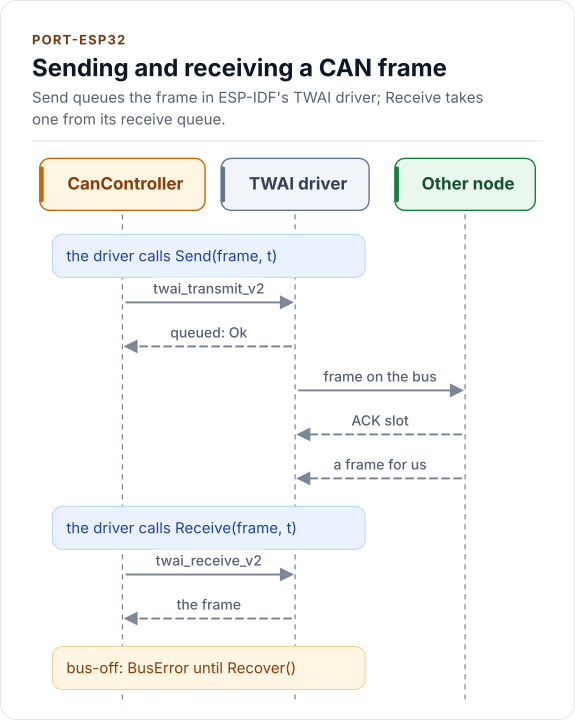
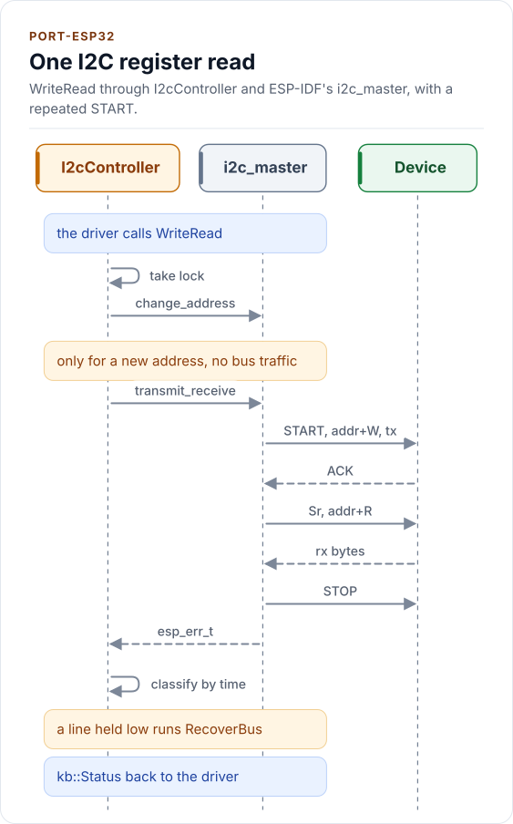
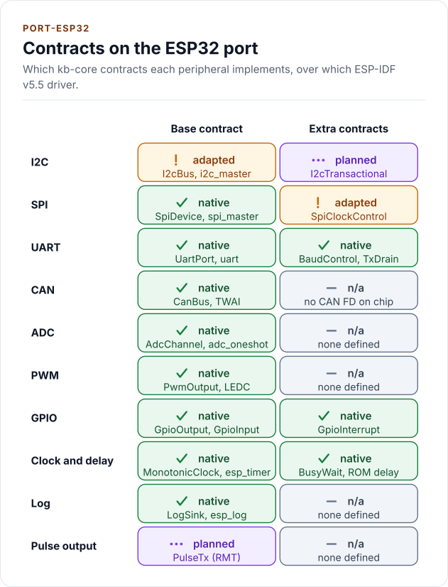
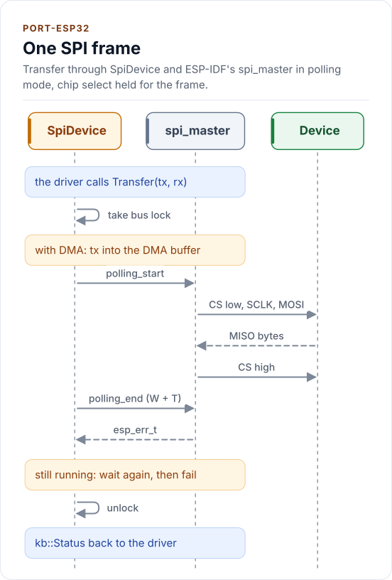
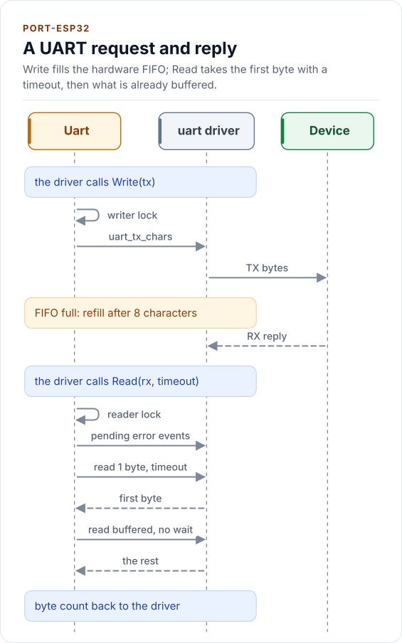

# Figures

<!-- Written by kokeb-docs figures from docs/diagrams/figures/*.py. Do not edit by hand. -->

Every figure on this site is drawn by a Python module from facts extracted from the code, so it is rebuilt,
not redrawn, when the code changes. CI runs `kokeb-docs figures --check` and fails when a
committed figure no longer matches the code. Each figure below lists the files it is drawn from.

## Sending and receiving a CAN frame

<!-- figure: can-send-receive -->
<picture>
  <source media="(prefers-color-scheme: dark)" srcset="can-send-receive.dark.svg">
  
</picture>
<!-- /figure -->

Hardware description: [`docs/model/can-send-receive.seq.yml`](../model/can-send-receive.seq.yml)

Drawn from:

- [`docs/model/can-send-receive.seq.yml`](../model/can-send-receive.seq.yml)
- [`inc/kb/port/esp32/can.hpp`](../../inc/kb/port/esp32/can.hpp)
- [`src/boundary/can.cpp`](../../src/boundary/can.cpp)
- [`src/can.cpp`](../../src/can.cpp)

## One I2C register read

<!-- figure: i2c-write-read -->
<picture>
  <source media="(prefers-color-scheme: dark)" srcset="i2c-write-read.dark.svg">
  
</picture>
<!-- /figure -->

Hardware description: [`docs/model/i2c-write-read.seq.yml`](../model/i2c-write-read.seq.yml)

Drawn from:

- [`docs/model/i2c-write-read.seq.yml`](../model/i2c-write-read.seq.yml)
- [`inc/kb/port/esp32/i2c.hpp`](../../inc/kb/port/esp32/i2c.hpp)
- [`src/boundary/i2c.cpp`](../../src/boundary/i2c.cpp)
- [`src/i2c.cpp`](../../src/i2c.cpp)

## Contracts on the ESP32 port

<!-- figure: port-contracts -->
<picture>
  <source media="(prefers-color-scheme: dark)" srcset="port-contracts.dark.svg">
  
</picture>
<!-- /figure -->

Hardware description: [`docs/model/port-contracts.matrix.yml`](../model/port-contracts.matrix.yml)

Drawn from:

- [`docs/model/port-contracts.matrix.yml`](../model/port-contracts.matrix.yml)
- [`inc/kb/port/esp32/can.hpp`](../../inc/kb/port/esp32/can.hpp)
- [`inc/kb/port/esp32/gpio.hpp`](../../inc/kb/port/esp32/gpio.hpp)
- [`inc/kb/port/esp32/i2c.hpp`](../../inc/kb/port/esp32/i2c.hpp)
- [`inc/kb/port/esp32/log.hpp`](../../inc/kb/port/esp32/log.hpp)
- [`inc/kb/port/esp32/port.hpp`](../../inc/kb/port/esp32/port.hpp)
- [`inc/kb/port/esp32/spi.hpp`](../../inc/kb/port/esp32/spi.hpp)
- [`inc/kb/port/esp32/time.hpp`](../../inc/kb/port/esp32/time.hpp)
- [`inc/kb/port/esp32/uart.hpp`](../../inc/kb/port/esp32/uart.hpp)
- [`src/i2c.cpp`](../../src/i2c.cpp)
- [`src/spi.cpp`](../../src/spi.cpp)

## One SPI frame

<!-- figure: spi-transfer -->
<picture>
  <source media="(prefers-color-scheme: dark)" srcset="spi-transfer.dark.svg">
  
</picture>
<!-- /figure -->

Hardware description: [`docs/model/spi-transfer.seq.yml`](../model/spi-transfer.seq.yml)

Drawn from:

- [`docs/model/spi-transfer.seq.yml`](../model/spi-transfer.seq.yml)
- [`inc/kb/port/esp32/spi.hpp`](../../inc/kb/port/esp32/spi.hpp)
- [`src/boundary/spi.cpp`](../../src/boundary/spi.cpp)
- [`src/spi.cpp`](../../src/spi.cpp)

## A UART request and reply

<!-- figure: uart-write-read -->
<picture>
  <source media="(prefers-color-scheme: dark)" srcset="uart-write-read.dark.svg">
  
</picture>
<!-- /figure -->

Hardware description: [`docs/model/uart-write-read.seq.yml`](../model/uart-write-read.seq.yml)

Drawn from:

- [`docs/model/uart-write-read.seq.yml`](../model/uart-write-read.seq.yml)
- [`inc/kb/port/esp32/uart.hpp`](../../inc/kb/port/esp32/uart.hpp)
- [`src/boundary/uart.cpp`](../../src/boundary/uart.cpp)
- [`src/uart.cpp`](../../src/uart.cpp)
