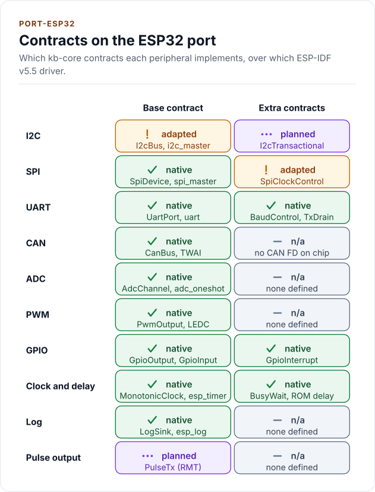

# port-esp32

kb-core's contracts (`kb::iface`) implemented over **ESP-IDF v5.5** for the **ESP32 family**: one C++20
library, namespace `kb::port::esp32`, that lets any driver written against the kb contracts run on an ESP32
without a line of ESP-IDF in the driver.

## The MCU at a glance

| | |
| --- | --- |
| Family | Espressif ESP32 (Xtensa LX6/LX7 and RISC-V cores) |
| Targets | `esp32`, `esp32s2`, `esp32s3`, `esp32c3`, `esp32c6`, `esp32h2`, `esp32p4` ([Targets](targets.md)) |
| SDK | ESP-IDF v5.5 (`release/v5.5`), the drivers `i2c_master`, `spi_master`, `uart`, `gpio`, `ledc`, `adc_oneshot` with `adc_cali`, `twai`, `esp_timer`, ROM delay and `esp_log` |
| RTOS | FreeRTOS (ESP-IDF's), through `kb::rtos` |
| Language | ISO C++20, no heap, no exceptions, no RTTI, no virtual functions |
| Level | High (kb-core ADR-0011): bounded building blocks, never a product's safety layer |

## Peripherals and contracts

| Peripheral | kb contract | Type | Page |
| --- | --- | --- | --- |
| I2C (HP controllers) | `I2cBus` | `I2cController` | [I2C](peripherals/i2c.md) |
| SPI2, SPI3 | `SpiDevice`, `SpiClockControl` | `SpiBus` + `SpiDevice` | [SPI](peripherals/spi.md) |
| UART (HP) | `UartPort`, `UartBaudControl`, `UartTxDrain` | `Uart` | [UART](peripherals/uart.md) |
| GPIO | `GpioOutput` / `GpioInput`, `GpioInterrupt` | `OutputPin` / `InputPin` | [GPIO](peripherals/gpio.md) |
| ADC (oneshot) | `AdcChannel` | `AdcChannel` | [ADC](peripherals/adc.md) |
| LEDC | `PwmOutput` | `PwmChannel` | [PWM](peripherals/pwm.md) |
| TWAI | `CanBus` | `CanController` | [CAN](peripherals/can.md) |
| esp_timer, ROM delay, esp_log | `MonotonicClock`, `BusyWait`, `LogSink` | `Clock`, `BusyWait`, `LogSink` | [Clock, delay and log](peripherals/time-log.md) |

The same at a glance: native where the contract maps onto the ESP-IDF driver, adapted where the port adds its own
logic to meet it (the I2C failure bands, a new SPI clock by adding the device again).

<!-- figure: port-contracts -->
<picture>
  <source media="(prefers-color-scheme: dark)" srcset="diagrams/port-contracts.dark.svg">
  
</picture>
<!-- /figure -->

Every type satisfies its concepts (`static_assert` beside its definition) and converts to the contract's
type-erased `*Ref` (`I2cBusRef`, `SpiDeviceRef`, ...), proven at compile time in `kb/port/esp32/port.hpp` and
at run time in the host tests.

What the port does **not** implement, and why:

| Not implemented | Why |
| --- | --- |
| `PulseTx` (RMT) | Not yet a kb-core contract (planned with the ws2812 handler); ESP-IDF's RMT driver is used directly until then |
| LP I2C, LP UART | Low-power cores' peripherals; kb-core has no low-power contract |
| CAN FD | `CanFrame` is classic CAN; the ESP32 TWAI controllers are classic CAN only |
| `I2cTransactional`, asynchronous I2C/SPI | Planned kb-core contracts (M4, M5), not yet defined |

## Rules that hold everywhere

- **Every wait is bounded**: by the configured timeout, each capped at `kMaxTimeout` (2 s), kb-core's "no
  limit" included. The one `portMAX_DELAY` ESP-IDF requires (the SPI polling bus lock) is taken only when the
  port has shown it free. Each peripheral page gives the worst case of a call.
- **Errors are values**: every call returns `kb::Status` or `kb::Result<T>`; the ESP-IDF `esp_err_t` is kept as
  the vendor code (`Detail()`, and `LastError()` on every object). See [Error mapping](error-mapping.md).
- **Bus recovery**: I2C stuck-bus detection and nine-clock recovery (and a reset at start-up), SPI waits sized to
  the frame with a failed-host state when a transaction never ends, CAN bus-off recovery.
- **Thread safety**: a lock per controller, bounded; see [Thread safety](thread-safety.md).
- **MISRA boundary**: only the boundary files in `src/boundary/` (one per SDK component) include ESP-IDF headers
  ([MISRA boundary](deviations.md)).

## Start

[Getting started](getting-started.md) adds the port to an ESP-IDF project in three steps; the
[examples](examples.md) self test the port.
