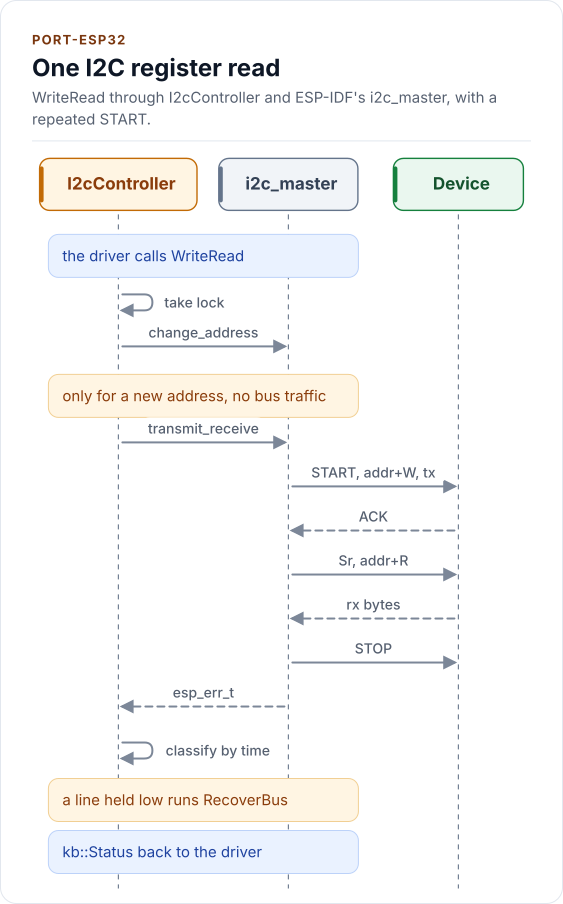

# I2C

`kb::port::esp32::I2cController` satisfies `kb::iface::I2cBus` over ESP-IDF's `i2c_master` driver
(`esp_driver_i2c`), synchronous mode only: the bus is created with `trans_queue_depth` 0. Do not use the same bus
handle for asynchronous transfers: ESP-IDF refuses a mix of synchronous and asynchronous operations on one
`i2c_master` bus (observed with an earlier implementation on ESP32-C6 with ESP-IDF v5.5, which returned
`ESP_ERR_INVALID_STATE`).

## How it works

| Step | SDK call |
| --- | --- |
| `EnsureReady()` | Claims SDA and SCL, `i2c_new_master_bus` (port, SDA, SCL, default clock source, glitch filter, pull-ups), `i2c_master_bus_add_device` with one device handle (`scl_wait_us` from `stretch_limit_us`), then `i2c_master_bus_reset` once, so a transfer cut by a warm reset cannot leave a device holding SDA (its error when no line is held is ignored: ESP-IDF reports one then, which is normal) |
| A transfer to a new address | `i2c_master_device_change_address` on that handle (no bus traffic) |
| `Write(addr, tx)` | `i2c_master_transmit`; an empty `tx` is an address probe, `i2c_master_probe` |
| `WriteRead(addr, tx, rx)` | `i2c_master_transmit_receive` (repeated START) |
| `Read(addr, rx)` | `i2c_master_receive` |
| `RecoverBus()` | `i2c_master_bus_reset`: nine SCL clocks and a STOP, the controller reset; then SDA and SCL are read back |
| `Release()` | Under the controller lock (`Busy` when not had): `i2c_master_bus_rm_device`, `i2c_del_master_bus` |

<!-- figure: i2c-write-read -->
<picture>
  <source media="(prefers-color-scheme: dark)" srcset="../diagrams/i2c-write-read.dark.svg">
  
</picture>
<!-- /figure -->

The controller owns the port and its pins: a second `I2cController` on the same port, or any port object on SDA
or SCL, gets `Busy` from `EnsureReady()`.

## Pins and clock

| Item | Note |
| --- | --- |
| SDA, SCL | Any output-capable GPIO through the GPIO matrix (not input-only pins such as GPIO34-39 on ESP32) |
| Pull-ups | External 2.2 kOhm to 4.7 kOhm to the bus voltage. `internal_pullups` enables the weak internal ones (about 45 kOhm): enough for short buses at 100 kHz only |
| Clock | `clock_hz` 1 Hz to 1 MHz, from `I2C_CLK_SRC_DEFAULT`; the chip's own maximum applies (400 kHz on most targets for reliable operation) |
| Glitch filter | `glitch_filter_cycles` controller clock cycles (default 7) |

## Timing limits

| Wait | Bound |
| --- | --- |
| The controller lock | `I2cConfig::timeout` T (default 50 ms, at most `kMaxTimeout`, 2 s); `Busy` when not had, nothing is sent |
| ESP-IDF's own bus lock | At most T (`ESP_ERR_TIMEOUT`: `Busy`, nothing sent) |
| One transfer of n bytes | At most T for each hardware command batch (a batch moves up to one FIFO, 32 bytes on most chips): T x (2 + ceil(n / 32)) with the lock waits, on a bus that stops raising interrupts. A stretched or stuck bus ends at the SCL limit first |
| Clock stretching | `I2cConfig::stretch_limit_us` (0: the SDK default, 2 ms on most chips, 2.5 ms on ESP32-H2) is the longest SCL low phase; a longer one ends the transfer with a failure that the time bands below classify. Raise it for a device that stretches for long (some secure elements stretch for hundreds of milliseconds during non-volatile writes); the chip caps it (ESP32: about 13 ms), the port uses the capped value (and none at all, every failure before the wire time then ambiguous, when the controller clock cannot be read), values above `kMaxTimeout` are refused, and it applies to every device of the controller |
| A failed transfer | With the probe allowed for the address: one probe (at most T plus ESP-IDF's 20 ms stretch limit for probes); with a stuck line and `auto_recover`: one recovery (at most 50 ms) |
| Per call | `Write`, `WriteRead` and `Read` also take their own timeout (capped at `kMaxTimeout`), for a device that needs another T |

Every millisecond value handed to ESP-IDF is rounded up to whole RTOS ticks, plus one for the tick in progress.
ESP-IDF converts with `pdMS_TO_TICKS`, which rounds down, so at its default 100 Hz tick a 1 to 9 ms timeout would
otherwise be a zero-tick poll (observed with an RTOS tick of 100 Hz in an earlier implementation: rounding down
turned 1 to 9 ms delays into no delay and short timeouts into polls).

## Results and failure kinds

ESP-IDF v5.5 returns one code, `ESP_ERR_INVALID_STATE`, for a transfer that did not complete: a NACK of the
address, a NACK of a data byte, a clock stretch past the SCL limit, a software timeout and lost arbitration alike
(ESP-IDF v6.0 returns `ESP_ERR_INVALID_RESPONSE` for all of them; the boundary picks the code by
`ESP_IDF_VERSION`). `ESP_ERR_TIMEOUT` means only that ESP-IDF's bus lock was not had. The controller therefore
classifies a failed transfer by its time, in three bands:

| Elapsed time of the failed call | Meaning | Reported |
| --- | --- | --- |
| Shorter than the earliest timeout: the SCL limit the hardware applies (`stretch_limit_us` or the SDK default, capped as the chip caps it; the register rounds up, never down) or the call's own timeout, whichever is shorter | Only a NACK ends this fast | `Nack` (`DataNack`), or split by the probe when allowed |
| Longer than the wire time at `clock_hz` (nine bits per byte and address, plus START and STOP) plus `kI2cNackSlackUs` (1 ms) | A NACK cannot end this late | `Timeout`, or `BusError` (`BusStuck`) with a line low |
| Between the two (a stretch timeout early in a transfer longer than the SCL limit, or a NACK delayed by preemption) | Ambiguous | `BusError` (`Bus`, unsplit), never `DataNack`; with the probe allowed: `NoDevice` when the address is not acknowledged, else `Bus` |

A NACK is reported as `Nack` by default, without telling the address from a data byte, because the only way to
tell them apart is an extra address-only frame, and some devices NACK every poll while busy and must not receive
extra frames. `AllowNackProbe(address, true)` lets the controller probe that address once after a NACK.

| Result | `LastFailure()` | When |
| --- | --- | --- |
| `Ok` | `None` | The transfer completed |
| `Nack` | `DataNack` | A fast failure and the probe not allowed (unsplit: address or data); or the probe acknowledged (a data byte was refused) |
| `NoDevice` | `AddressNack` | A fast or ambiguous failure and the allowed probe not acknowledged (`ESP_ERR_NOT_FOUND`); or an empty write's probe not acknowledged |
| `Timeout` | `Timeout` | A failure later than the wire time plus the slack, with both lines high; or the probe timed out |
| `BusError` | `Bus` | An ambiguous failure (see the bands); another SDK failure, or a failed probe, with both lines high |
| `BusError` | `BusStuck` | Any failure with SDA or SCL read low afterwards; with `auto_recover` (default) RecoverBus() runs at once |
| `Busy` | `Timeout` | The controller lock, or ESP-IDF's bus lock (`ESP_ERR_TIMEOUT` of a transfer), was not had; nothing was sent |
| `InvalidArgument` | `Bus` | Address outside 0x08 to 0x77, an empty read, a zero timeout, the SDK refused the arguments |
| `NotReady` | `Bus` | Before `EnsureReady()` or after `Release()` |

Residual limits of the bands: lost arbitration (multi-master buses only) ends fast and is reported as a NACK; a
task preempted while its transfer fails on a NACK can be reported in the ambiguous band (`Bus`) or, preempted
for longer than the earliest timeout and the wire time, as `Timeout` (on a single core with Wi-Fi at a high
priority a few milliseconds are ordinary). Neither is ever reported as a successful transfer.

`LastError().Detail()` is the `esp_err_t` of the failing call. `LastFailure()` and `LastError()` report the
calling task's own last call on the controller, so a task sharing the controller never reads another task's
failure. `Stats()` counts transfers, failures, recoveries and lock timeouts.

## Bus recovery

A slave that lost a clock edge (a reset in the middle of a read, a glitch) can hold SDA low forever. After any
failed transfer the controller reads SDA and SCL; when one is low the failure is `BusStuck` and, with
`auto_recover`, `RecoverBus()` follows at once: `i2c_master_bus_reset` clocks SCL nine times so the slave can
finish its byte, sends a STOP and resets the controller. The transfer itself is not retried: the caller decides.
A line still low after the recovery is reported as `BusError` with `LastFailure()` `BusStuck` (a hardware fault:
a short, a missing pull-up, a device in reset).

## Example

```cpp
esp::I2cController bus{cfg};
std::array<uint8_t, 2> rx{};
const std::array<uint8_t, 1> reg{0x00U};
static_cast<void>(bus.AllowNackProbe(0x4AU, true)); // this device may get one probe after a NACK
if (bus.WriteRead(0x4AU, reg, rx) == kb::Status::NoDevice) {
  // nothing at 0x4A: check the address strap and the wiring
}
```
